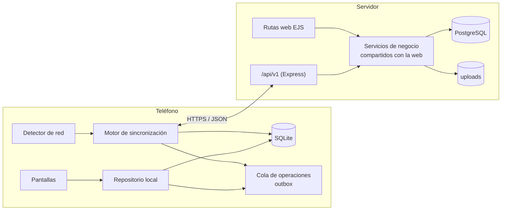
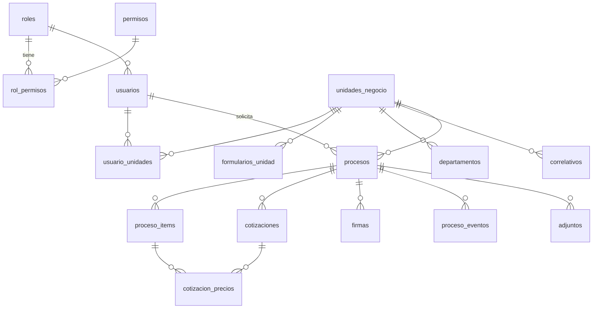
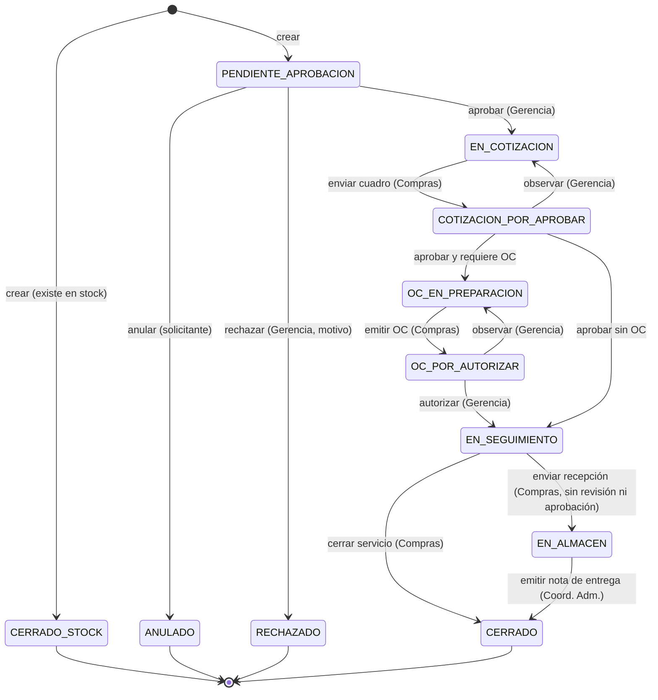
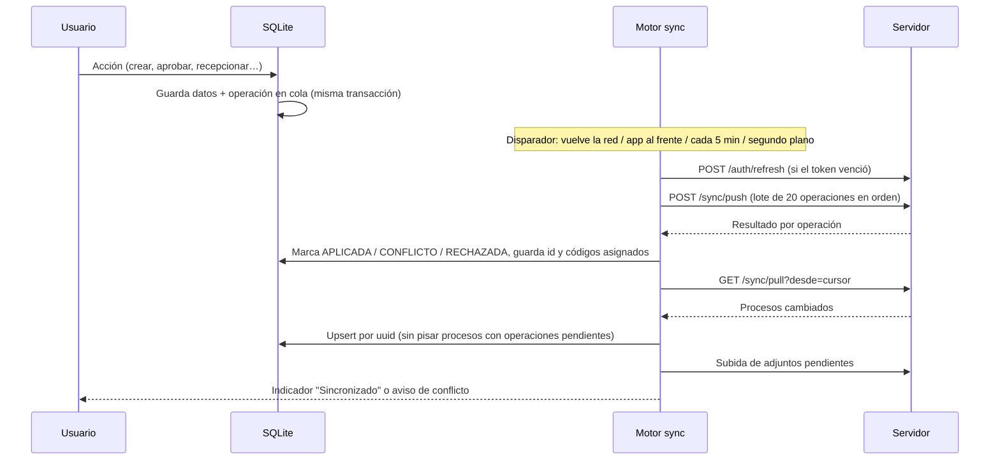

# App móvil del Proceso de Compras — Documentación técnica

Guía para implementar una app móvil que trabaje sobre la misma base de datos del sistema web **proceso_compra**, que funcione **sin internet** (guardando todo en el teléfono) y que **sincronice sola** cuando vuelva la conexión.

> Estado actual: el sistema web es un monolito Express + EJS que solo responde HTML. **No existe todavía una API JSON.** Este documento describe (1) cómo es el sistema hoy, (2) qué hay que agregar al servidor y (3) cómo construir la app.

---

## Índice

1. [Resumen del sistema actual](#1-resumen-del-sistema-actual)
2. [Arquitectura propuesta](#2-arquitectura-propuesta)
3. [Modelo de datos (servidor)](#3-modelo-de-datos-servidor)
4. [Flujo de negocio y máquina de estados](#4-flujo-de-negocio-y-máquina-de-estados)
5. [Roles, permisos y visibilidad](#5-roles-permisos-y-visibilidad)
6. [Cambios necesarios en el servidor](#6-cambios-necesarios-en-el-servidor)
7. [API REST para la app](#7-api-rest-para-la-app)
8. [App móvil: stack y estructura](#8-app-móvil-stack-y-estructura)
9. [Base de datos local (SQLite)](#9-base-de-datos-local-sqlite)
10. [Modo sin conexión y sincronización](#10-modo-sin-conexión-y-sincronización)
11. [Conflictos y casos especiales](#11-conflictos-y-casos-especiales)
12. [Adjuntos (fotos, PDF, facturas)](#12-adjuntos-fotos-pdf-facturas)
13. [Seguridad](#13-seguridad)
14. [Pruebas](#14-pruebas)
15. [Plan de implementación por fases](#15-plan-de-implementación-por-fases)
16. [Decisiones pendientes](#16-decisiones-pendientes)

---

## 1. Resumen del sistema actual

Sistema del **Proceso Integral de Gestión de Compras y Adquisición de Servicios** (ISO 9001) para 6 unidades de negocio:

| Sigla | Unidad | Código de revisión |
|---|---|---|
| RV | Río Verde | RV.26.001 |
| ZB | Zentta Bio | ZB.26.001 |
| CSR | Cabaña Santa Rosa | CSR.26.001 |
| RA | RevoAgro | RA.26.001 |
| A | Agroptima | A.26.001 |
| LS360 | LaSierra360 | LS360.26.001 |

### Stack

| Capa | Tecnología |
|---|---|
| Servidor | Node.js 20+, Express 4 |
| Vistas | EJS + express-ejs-layouts (HTML renderizado en el servidor) |
| Base de datos | PostgreSQL 16 (`pg`) |
| Sesiones | `express-session` + `connect-pg-simple` (tabla `session`), cookie `pc.sid` |
| Seguridad | bcryptjs, token CSRF en sesión, límite de 5 intentos de login / 10 min |
| Archivos | multer → disco (`UPLOADS_DIR`), máx. 15 MB y 10 archivos por envío |
| Despliegue | Docker Compose (`app` + `db`), zona horaria `America/La_Paz` |

### Estructura del código

```
app.js                    Arranque, middlewares, sesiones, migración al iniciar
config/db.js              Pool de PostgreSQL + helper db.transaccion(fn)
database/schema.sql       Esquema idempotente (se aplica en cada arranque)
database/migrate.js       Carga permisos, roles, unidades, formularios, departamentos y admin inicial
routes/index.js           Todas las rutas
controllers/
  authController.js       Login, logout, cambio de contraseña
  procesoController.js    Inicio ("Mis tareas"), listado, nueva solicitud, detalle, impresión, adjuntos
  flujoController.js      Las acciones del flujo (aprobar, cotizar, OC, recepción, nota de entrega…)
  acciones.js             calcularAcciones(usuario, proceso): qué puede hacer el usuario ahora
  adminController.js      Usuarios, roles/permisos, unidades y departamentos
models/                   Consultas SQL (procesos, usuarios, roles, unidades)
middlewares/auth.js       Carga de usuario, login requerido, permisos, CSRF, flash
middlewares/subidas.js    Subida de adjuntos y logos
utils/constantes.js       ESTADOS, PASOS, CRITERIOS, tipos, cotizacionesRequeridas()
utils/correlativo.js      Correlativo atómico por unidad/tipo/año
utils/pasos.js            Cálculo de los 5 pasos y "qué sigue"
utils/formato.js          Formato de dinero, fechas y códigos (RV-REQ-1, RV-1)
views/                    Pantallas EJS e impresión
tests/e2e.js              Prueba de punta a punta (solo contra base de pruebas)
```

### Reglas de negocio clave (no cambiar sin consultar)

- **Correlativos** por unidad, **sin ceros a la izquierda**, se **reinician cada año** (`gestion`):
  - Requerimiento `RV-REQ-1`, Orden de compra `RV-1`, Nota de entrega `N° 1`.
  - Los asigna el servidor con `INSERT … ON CONFLICT DO UPDATE` sobre la tabla `correlativos` (atómico).
- El **código de revisión** (`RV.26.001`) es fijo; solo cambia cuando se revisa el formulario. **No es un correlativo.**
- La **aprobación con un clic** en el sistema es la firma válida; la impresión es secundaria.
- **Escala de cotizaciones** según monto en Bs (si es en USD se multiplica por `tipo_cambio`, 6.96 por defecto):

  | Monto | Cotizaciones requeridas |
  |---|---|
  | ≤ Bs 1.000 | 0 (pero se exige al menos 1 proveedor) |
  | Bs 1.001 – 3.000 | 1 |
  | Bs 3.001 – 20.000 | 2 |
  | > Bs 20.000 | 3 |

  Gerencia puede **desbloquear** con motivo (`excepcion_cotizaciones`).
- La OC solo aplica si `requiere_oc` (producto crítico / activo fijo). Los **servicios** no tienen OC obligatoria ni nota de entrega: se cierran tras el seguimiento.
- Si `existe_stock`, la solicitud nace en `CERRADO_STOCK`.
- Rechazos y observaciones **exigen comentario**.

---

## 2. Arquitectura propuesta

**La app nunca se conecta directo a PostgreSQL.** Habla con una API REST nueva dentro del mismo servidor Node, que reutiliza los mismos modelos y reglas.



Por qué no conectar la app directo a la BD:

- Las credenciales de PostgreSQL quedarían dentro de la app (cualquiera puede extraerlas).
- Se saltarían las validaciones, los permisos, la visibilidad por unidad y la máquina de estados.
- Los correlativos y las firmas deben generarse en un solo lugar.
- PostgreSQL no está pensado para conexiones inestables desde internet.

**Principio de la sincronización:** el teléfono es la fuente de verdad *mientras está offline*; el servidor es la fuente de verdad *final*. Todo lo que el usuario hace se guarda primero en SQLite y se registra como una **operación** en una cola. Cuando hay red, la cola se envía en orden y luego se descargan los cambios del servidor.

---

## 3. Modelo de datos (servidor)

Fuente: [database/schema.sql](../database/schema.sql).



| Tabla | Contenido | ¿Va al teléfono? |
|---|---|---|
| `roles`, `permisos`, `rol_permisos` | Seguridad | Solo los permisos del usuario conectado |
| `usuarios` | Usuarios (con `password_hash`) | Solo el propio (sin hash) y nombres/cargos para mostrar firmas |
| `unidades_negocio` | Datos de cada unidad, logo, textos de OC | Sí (catálogo) — las unidades del usuario |
| `usuario_unidades` | Unidades asignadas a cada usuario | Solo las del usuario |
| `formularios_unidad` | Código, revisión y fecha de cada formulario | Sí (catálogo) |
| `departamentos` | Departamentos por unidad | Sí (catálogo) |
| `correlativos` | Último número por unidad/tipo/año | **No** (solo el servidor numera) |
| `procesos` | Cabecera del proceso: solicitud, cuadro, OC, recepción, ingreso, entrega, egreso | Sí, los visibles |
| `proceso_items` | Ítems; incluye datos de recepción y cantidad entregada | Sí |
| `cotizaciones`, `cotizacion_precios` | Hasta 3 proveedores, criterios (JSONB `{"1":8,…}`) y precios por ítem | Sí |
| `firmas` | Aprobaciones con un clic (`documento` + `tipo`, únicas por proceso) | Sí (lectura) |
| `proceso_eventos` | Historial | Sí (lectura) |
| `adjuntos` | Metadatos de archivos | Metadatos sí; el archivo se descarga bajo demanda |
| `session` | Sesiones web | No |

### Firmas que existen

| `documento` | `tipo` | Quién / cuándo |
|---|---|---|
| `SOLICITUD` o `ACTA_TECNOLOGICO` | `SOLICITADO` | Solicitante, al crear |
| | `AUTORIZADO` | Gerencia, al aprobar la solicitud |
| | `RECIBIDO` | Compras, al guardar el cuadro por primera vez |
| `CUADRO` | `EVALUADOR` | Compras, al enviar el cuadro (se borra si Gerencia observa) |
| | `APROBADO` | Gerencia |
| `ORDEN_COMPRA` | `SOLICITADO` | Compras, al emitir (se borra si Gerencia observa) |
| | `AUTORIZADO` | Gerencia |
| `RECEPCION` | `RECEPCIONADO` | Compras (se borra si Gerencia observa) |
| | `REVISADO` | Coord. Adm. y RRHH (se borra si Gerencia observa) |
| | `APROBADO` | Gerencia |
| `NOTA_ENTREGA` | `ENTREGADO` | Coord. Adm. y RRHH |
| | `RECIBIDO` | Solicitante confirma recepción |

---

## 4. Flujo de negocio y máquina de estados

Fuente: [utils/constantes.js](../utils/constantes.js), [controllers/flujoController.js](../controllers/flujoController.js), [controllers/acciones.js](../controllers/acciones.js).



### Las 5 pantallas/pasos (un documento por paso)

| Paso | Documento | Estados del paso |
|---|---|---|
| 1 | Solicitud / Acta de equipo tecnológico | `PENDIENTE_APROBACION`, `RECHAZADO`, `ANULADO`, `CERRADO_STOCK` |
| 2 | Cuadro comparativo | `EN_COTIZACION`, `COTIZACION_POR_APROBAR` |
| 3 | Orden de compra (solo si `requiere_oc`) | `OC_EN_PREPARACION`, `OC_POR_AUTORIZAR` |
| 4 | Recepción (servicios: "Cierre") | `EN_SEGUIMIENTO` |
| 5 | Nota de entrega (no aplica a servicios) | `EN_ALMACEN` |

### Acciones (todas validan estado + permiso en el servidor)

| Acción | Ruta web actual | Estado requerido | Permiso / condición | Validaciones |
|---|---|---|---|---|
| Crear solicitud | `POST /procesos` | — | `procesos.crear` + unidad asignada | unidad, tipo, departamento de la unidad, ≥1 ítem con descripción y cantidad > 0; motivo si es equipo tecnológico |
| Anular | `POST /procesos/:id/anular` | `PENDIENTE_APROBACION` | ser el solicitante | — |
| Aprobar/rechazar solicitud | `…/aprobar-solicitud` (`decision=rechazar`) | `PENDIENTE_APROBACION` | `solicitud.aprobar` | comentario obligatorio al rechazar |
| Guardar/enviar cuadro | `…/cuadro` (`accion=enviar`) | `EN_COTIZACION` | `cotizacion.gestionar` | al enviar: ≥1 proveedor, adjudicado con precio en todos los ítems, justificación, nº de cotizaciones según escala |
| Excepción de cotizaciones | `…/excepcion` | `EN_COTIZACION`, `COTIZACION_POR_APROBAR` | `cotizacion.desbloquear` | motivo obligatorio |
| Aprobar/observar cuadro | `…/aprobar-cuadro` (`decision=observar`) | `COTIZACION_POR_APROBAR` | `cotizacion.aprobar` | comentario al observar |
| Guardar/emitir OC | `…/orden-compra` (`accion=emitir`) | `OC_EN_PREPARACION` | `oc.emitir` | al emitir: plazo, condición de pago, lugar de entrega, descuento ≤ total. **Asigna nº de OC** |
| Autorizar/observar OC | `…/autorizar-oc` | `OC_POR_AUTORIZAR` | `oc.autorizar` | comentario al observar |
| Nota de seguimiento | `…/seguimiento` | `OC_POR_AUTORIZAR`, `EN_SEGUIMIENTO` | `seguimiento.registrar` | comentario obligatorio |
| Cerrar servicio | `…/cerrar-servicio` | `EN_SEGUIMIENTO` y servicio | `seguimiento.registrar` | comentario obligatorio |
| Guardar/enviar recepción | `…/recepcion` (`accion=enviar`) | `EN_SEGUIMIENTO` y no servicio | `recepcion.registrar` | al enviar: fecha, tipo de bien, cantidad y estado por ítem |
| Guardar/emitir nota de entrega | `…/entrega` (`accion=entregar`) | `EN_ALMACEN` | `entrega.registrar` | al entregar: fecha, a quién, ≥1 cantidad > 0. **Asigna nº de NE** |
| Confirmar recepción (opcional) | `…/confirmar-entrega` | `CERRADO` con NE | ser el solicitante | — |

Protección contra dobles aprobaciones: `procesoModel.transicion()` hace `UPDATE … WHERE estado = ANY(desde)`. Si nadie fue actualizado, lanza *"El proceso cambió de estado mientras realizaba la acción"*. **La sincronización se apoya en este mismo mecanismo** para detectar conflictos.

---

## 5. Roles, permisos y visibilidad

| Rol (`codigo`) | Permisos por defecto |
|---|---|
| `ADMIN` | Todos |
| `GERENCIA` | `procesos.crear`, `procesos.ver_todos`, `solicitud.aprobar`, `cotizacion.aprobar`, `cotizacion.desbloquear`, `oc.autorizar` |
| `COORDINADOR_AREA` | `procesos.crear` |
| `RESPONSABLE_COMPRAS` | `procesos.crear`, `procesos.ver_unidades`, `cotizacion.gestionar`, `oc.emitir`, `seguimiento.registrar`, `recepcion.registrar` |
| `CONTADOR` | `procesos.crear`, `procesos.ver_unidades` |
| `COORD_ADM` | `procesos.crear`, `procesos.ver_unidades`, `entrega.registrar` |

Los permisos de cada rol se editan desde la web (**Roles**), así que la app **no debe tener los permisos fijos en el código**: los descarga del servidor.

**Visibilidad** ([models/procesoModel.js](../models/procesoModel.js) → `visibilidad()` / `puedeVer()`):

- `procesos.ver_todos` → todos los procesos.
- `procesos.ver_unidades` → los propios + los de sus unidades asignadas.
- Resto → solo los que creó.

El servidor aplica exactamente este filtro al responder a la app. El teléfono solo guarda lo que el usuario puede ver.

La administración (usuarios, roles, unidades) **queda solo en la web**; no se incluye en la app.

---

## 6. Cambios necesarios en el servidor

### 6.1 Extraer la lógica de negocio a servicios

> **Hecho (20/11/2026).** `services/flujoService.js` (las 16 acciones, `ejecutar(usuario, procesoId, accion, datos, ctx)`), `services/procesoService.js` (`crearSolicitud`, acepta `uuid` del cliente), `services/acciones.js` (antes en `controllers/`) y `utils/errores.js` (errores tipados con `codigo` y `status` HTTP). `ctx = { origen, fechaCliente, estadoEsperado }`. Los controladores web quedaron como adaptadores.

Antes la lógica vivía dentro de los controladores (leen `req.body`, hacen `req.flash` y `res.redirect`). Para que la web y la API usen **las mismas reglas**, mover cada acción a una función pura:

```
services/
  solicitudService.js   crear(usuario, datos)
  flujoService.js       aprobarSolicitud(usuario, procesoId, datos), guardarCuadro(...), ...
```

Cada servicio recibe `(usuario, procesoId, datos)`, valida, ejecuta la transacción y devuelve el resultado o lanza `ErrorValidacion` / error de flujo. Los controladores web quedan como adaptadores (form → servicio → redirect) y la API como otro adaptador (JSON → servicio → JSON). `calcularAcciones` y `cotizacionesRequeridas` ya son funciones puras: se reutilizan tal cual (y se pueden copiar a la app, ver §8).

### 6.2 Identificadores globales (UUID)

El teléfono crea registros sin red, así que no puede conocer el `id` que asignará PostgreSQL. Agregar un UUID generado por el cliente:

```sql
-- Requiere PostgreSQL 13+ (gen_random_uuid nativo)
ALTER TABLE procesos        ADD COLUMN IF NOT EXISTS uuid UUID NOT NULL DEFAULT gen_random_uuid();
ALTER TABLE proceso_items   ADD COLUMN IF NOT EXISTS uuid UUID NOT NULL DEFAULT gen_random_uuid();
ALTER TABLE cotizaciones    ADD COLUMN IF NOT EXISTS uuid UUID NOT NULL DEFAULT gen_random_uuid();
ALTER TABLE adjuntos        ADD COLUMN IF NOT EXISTS uuid UUID NOT NULL DEFAULT gen_random_uuid();
CREATE UNIQUE INDEX IF NOT EXISTS ux_procesos_uuid      ON procesos (uuid);
CREATE UNIQUE INDEX IF NOT EXISTS ux_items_uuid         ON proceso_items (uuid);
CREATE UNIQUE INDEX IF NOT EXISTS ux_cotizaciones_uuid  ON cotizaciones (uuid);
CREATE UNIQUE INDEX IF NOT EXISTS ux_adjuntos_uuid      ON adjuntos (uuid);
```

La web sigue usando `id`; la app usa `uuid`. Los registros creados desde la web reciben UUID automáticamente.

> **Atención:** `persistirCuadro()` hoy **borra y vuelve a insertar** las cotizaciones en cada guardado, así que su `id` cambia. Con UUID enviado por el cliente hay que hacer *upsert* por `uuid` (o por `(proceso_id, orden)`) en vez de borrar todo, para que el teléfono no pierda la referencia.

### 6.3 Versión de cambios para sincronización incremental

```sql
CREATE SEQUENCE IF NOT EXISTS sync_version_seq;
ALTER TABLE procesos ADD COLUMN IF NOT EXISTS sync_version BIGINT NOT NULL DEFAULT nextval('sync_version_seq');
CREATE INDEX IF NOT EXISTS ix_procesos_sync_version ON procesos (sync_version);

-- Cualquier cambio en el proceso o en sus tablas hijas sube la versión del proceso
CREATE OR REPLACE FUNCTION tocar_proceso() RETURNS trigger AS $$
DECLARE pid BIGINT;
BEGIN
  IF TG_TABLE_NAME = 'procesos' THEN
    NEW.sync_version := nextval('sync_version_seq');
    RETURN NEW;
  END IF;
  IF TG_TABLE_NAME = 'cotizacion_precios' THEN
    SELECT proceso_id INTO pid FROM cotizaciones WHERE id = COALESCE(NEW.cotizacion_id, OLD.cotizacion_id);
  ELSE
    pid := COALESCE(NEW.proceso_id, OLD.proceso_id);
  END IF;
  UPDATE procesos SET sync_version = nextval('sync_version_seq') WHERE id = pid;
  RETURN NULL;
END $$ LANGUAGE plpgsql;
-- Trigger BEFORE UPDATE en procesos; AFTER INSERT/UPDATE/DELETE en proceso_items, cotizaciones,
-- cotizacion_precios, firmas, proceso_eventos y adjuntos.
```

El **proceso es la unidad de sincronización** (un "agregado"): si algo cambia, el teléfono baja el proceso completo con sus hijos. Es simple y los procesos son pequeños.

> Una secuencia no garantiza orden de *commit*: una transacción larga puede confirmar una versión menor después de que el cliente ya leyó una mayor. Solución: en `pull`, devolver solo versiones menores que la más baja de las transacciones aún abiertas, o más simple, **pedir siempre desde `cursor − margen`** (p. ej. las últimas 200 versiones) y hacer *upsert* idempotente en el teléfono.

### 6.4 Registro de operaciones (idempotencia)

Si la red se corta después de que el servidor procesó una operación pero antes de que el teléfono reciba la respuesta, el teléfono la reenviará. El servidor debe reconocerla y no ejecutarla dos veces:

```sql
CREATE TABLE IF NOT EXISTS sync_operaciones (
  op_id        UUID PRIMARY KEY,               -- generado en el teléfono
  usuario_id   BIGINT NOT NULL REFERENCES usuarios(id),
  dispositivo  VARCHAR(100) NOT NULL,
  tipo         VARCHAR(40) NOT NULL,
  proceso_uuid UUID,
  estado       VARCHAR(20) NOT NULL,           -- APLICADA | RECHAZADA | CONFLICTO
  respuesta    JSONB NOT NULL,                 -- lo que se respondió (se repite tal cual si llega de nuevo)
  creada_cliente TIMESTAMPTZ,                  -- cuándo la hizo el usuario en el teléfono
  recibida_en  TIMESTAMPTZ NOT NULL DEFAULT NOW()
);
```

La inserción en `sync_operaciones` va **dentro de la misma transacción** que la acción.

### 6.5 Auditoría de hora real

Una aprobación hecha sin red a las 09:00 puede llegar al servidor a las 16:00. Agregar a `firmas` y `proceso_eventos`:

```sql
ALTER TABLE firmas          ADD COLUMN IF NOT EXISTS fecha_cliente TIMESTAMPTZ;
ALTER TABLE firmas          ADD COLUMN IF NOT EXISTS origen VARCHAR(10) NOT NULL DEFAULT 'WEB'; -- WEB | MOVIL
ALTER TABLE proceso_eventos ADD COLUMN IF NOT EXISTS fecha_cliente TIMESTAMPTZ;
ALTER TABLE proceso_eventos ADD COLUMN IF NOT EXISTS origen VARCHAR(10) NOT NULL DEFAULT 'WEB';
```

`fecha` sigue siendo la del servidor (la que vale para ISO); `fecha_cliente` es informativa.

### 6.6 Autenticación por token

> **Hecho (20/11/2026).** JWT HS256 propio sin dependencias ([utils/jwt.js](../utils/jwt.js)), 1 h; refresh de 60 días con rotación y 2 min de gracia ([models/dispositivoModel.js](../models/dispositivoModel.js)). Detalle en §7.1. Definir **`JWT_SECRET`** en el `.env` de producción.

La web usa cookie de sesión + CSRF; eso no sirve bien en una app. Se agregaron tokens:

- **Access token** (JWT firmado, 1 h) con `sub = usuario_id` y `did = dispositivo`.
- **Refresh token** (aleatorio, 60 días), guardado **hasheado** en la BD, rotado en cada uso y revocable. La tabla real tiene además `refresh_anterior` y `rotado_en` (período de gracia).

```sql
CREATE TABLE IF NOT EXISTS dispositivos (
  id            UUID PRIMARY KEY,
  usuario_id    BIGINT NOT NULL REFERENCES usuarios(id) ON DELETE CASCADE,
  nombre        VARCHAR(100) NOT NULL DEFAULT '',
  refresh_hash  VARCHAR(100) NOT NULL,
  expira_en     TIMESTAMPTZ NOT NULL,
  revocado      BOOLEAN NOT NULL DEFAULT FALSE,
  ultimo_uso    TIMESTAMPTZ,
  creado_en     TIMESTAMPTZ NOT NULL DEFAULT NOW()
);
```

En cada petición se recargan permisos y unidades desde la BD (igual que `cargarUsuario` hoy), así un cambio de rol o una desactivación aplica de inmediato. Al desactivar un usuario en la web se revocan sus dispositivos. La ruta `/api/*` **no** usa CSRF (no hay cookies) y **sí** debe usar el mismo limitador de intentos del login.

### 6.7 Otros

- ✅ La API está montada en `app.js` **antes** de la sesión web y del CSRF; responde todos los errores en JSON.
- ✅ El puerto de la BD quedó en `127.0.0.1:5432` (solo accesible desde el propio servidor).
- ⏳ Servir detrás de **HTTPS** (Nginx / Caddy / Traefik). Activar `COOKIE_SECURE=true` en la web. **Obligatorio antes de usar la app fuera de la red local**: sin HTTPS los tokens viajan en texto plano.

---

## 7. API REST para la app

> **Implementada (20/11/2026).** Código: [routes/api.js](../routes/api.js), [controllers/api/](../controllers/api/), [middlewares/apiAuth.js](../middlewares/apiAuth.js). Prueba de punta a punta: [tests/api.js](../tests/api.js) (69 casos).

Base: `https://<servidor>/api/v1`. JSON en ambos sentidos (máx. 1 MB). Cabecera `Authorization: Bearer <access_token>` en todo salvo `/ping`, `/auth/login` y `/auth/refresh`. No usa cookies ni CSRF. Respuestas con `Cache-Control: no-store`.

Formato de error:

```json
{ "error": { "codigo": "VALIDACION", "mensaje": "Revise los datos.", "detalles": ["Ítem 1: la cantidad debe ser mayor a cero."] } }
```

| Código | HTTP | Cuándo | Qué hace la app |
|---|---|---|---|
| `NO_AUTORIZADO` | 401 | Falta el token | Ir a login |
| `TOKEN_INVALIDO` | 401 | Token alterado o de otro servidor | Ir a login |
| `TOKEN_VENCIDO` | 401 | Pasó 1 h | `POST /auth/refresh` y reintentar |
| `SESION_REVOCADA` | 401 | Logout, cambio de contraseña, usuario desactivado | Ir a login **sin borrar la cola** |
| `SESION_VENCIDA` | 401 | Refresh vencido (60 días), inválido o revocado | Ir a login sin borrar la cola |
| `USUARIO_INACTIVO` | 401 | Usuario desactivado | Avisar y bloquear |
| `CREDENCIALES` | 401 | Usuario o contraseña incorrectos | Mostrar mensaje |
| `DEMASIADOS_INTENTOS` | 429 | 5 fallos en 10 min (contador compartido con la web) | Esperar |
| `VALIDACION` | 422 | Datos inválidos (`detalles[]`) | Mostrar y dejar corregir |
| `ACCION_NO_DISPONIBLE` | 403 | No le corresponde en este estado | Refrescar el proceso |
| `NO_ENCONTRADO` | 404 | No existe **o no lo puede ver** (no se distingue) | Quitarlo del teléfono |
| `CONFLICTO_ESTADO` | 409 | Otra persona cambió el estado antes | Ver §11.1 |
| `JSON_INVALIDO` / `CUERPO_GRANDE` | 400 / 413 | Petición mal formada | Error de programación |
| `ERROR` | 500 | Error interno | Reintentar con espera |

### 7.1 Autenticación

| Método | Ruta | Uso |
|---|---|---|
| GET | `/ping` | Sin token. `{ ok, hora }`: para saber si hay internet de verdad |
| POST | `/auth/login` | `{usuario, password, dispositivo_id, dispositivo_nombre}` → tokens + perfil |
| POST | `/auth/refresh` | `{dispositivo_id, refresh_token}` → tokens nuevos (rota el refresh) + perfil |
| POST | `/auth/logout` | Cierra la sesión de este dispositivo |
| GET | `/auth/yo` | Perfil actual (permisos y unidades al día) |
| POST | `/auth/password` | `{actual, nueva}`. Cierra la sesión en los **demás** teléfonos del usuario |

- `dispositivo_id`: UUID que la app genera **una vez por instalación** y guarda.
- Access token: JWT HS256, **1 hora**, firmado con `JWT_SECRET` (o `SESSION_SECRET` si no se define). Contiene `sub` (usuario) y `did` (dispositivo).
- Refresh token: aleatorio, **60 días**, guardado como SHA-256 en `dispositivos`, **rota en cada uso**. El anterior se acepta **2 minutos** después de rotar, por si la respuesta se perdió; pasado eso, no.
- En **cada** petición se comprueba que el dispositivo no esté revocado y que el usuario siga activo, y se recargan permisos y unidades.
- Se revocan las sesiones de la app cuando: el usuario hace logout; cambia su contraseña (web o app); el administrador lo desactiva o le cambia la contraseña desde la web.
- La app debe hacer **un solo refresh a la vez** (candado).

Respuesta de login / refresh:

```json
{
  "access_token": "eyJ…", "expira_en": 3600, "refresh_token": "b1f…",
  "usuario": { "id": 12, "usuario": "jperez", "nombre": "Juan Pérez", "cargo": "Responsable de Compras", "email": "",
               "rol_codigo": "RESPONSABLE_COMPRAS", "rol_nombre": "Responsable de Compras",
               "permisos": ["procesos.crear", "..."], "unidades": [1, 3] }
}
```

### 7.2 Catálogos

`GET /catalogos`: todo lo necesario para trabajar sin red. Responde con `ETag`; con `If-None-Match` igual devuelve **304**.

```json
{
  "usuario": { "…perfil…": "" },
  "unidades": [{ "id": 1, "sigla": "RV", "nombre": "Río Verde", "razon_social": "…", "nit": "…", "direccion": "…", "telefono": "…",
                 "logo_url": "/img/Logo_Rio_Verde.png", "codigo_revision": "RV.26.001", "lugar_entrega": "…",
                 "lugar_cobranza": "…", "datos_factura": "…", "notas_oc": "…" }],
  "departamentos": [{ "id": 4, "unidad_id": 1, "nombre": "Operaciones" }],
  "formularios": [{ "unidad_id": 1, "tipo": "SOLICITUD", "codigo": "RV.FCOM.01.1", "revision": "0", "fecha": "18/02/2025" }],
  "constantes": {
    "estados": {}, "estados_finales": [], "pasos": [], "tipos_solicitud": {}, "prioridades": {}, "monedas": {},
    "tipos_bien": {}, "estados_inspeccion": [], "criterios": [], "formularios": {}, "etapas_adjunto": {},
    "escala_cotizaciones": [[1000, 0], [3000, 1], [20000, 2], [null, 3]], "tipo_cambio_defecto": 6.96,
    "tipos_operacion": ["CREAR_SOLICITUD", "ANULAR", "…"],
    "operaciones_solo_en_linea": ["APROBAR_SOLICITUD", "EXCEPCION_COTIZACIONES", "APROBAR_CUADRO", "AUTORIZAR_OC"],
    "adjuntos": { "extensiones": [".pdf", "…"], "max_bytes": 15728640 }
  }
}
```

- Las unidades son las que el usuario puede usar para crear solicitudes (todas las activas si tiene `procesos.ver_todos`).
- No se envía la lista de usuarios: los nombres ya vienen en firmas, eventos y procesos.
- **El ETag incluye el perfil** (permisos y unidades). Si cambia, la app debe hacer un **pull completo** (`desde=0`) y luego `/sync/visibles`, porque pudo ganar o perder acceso a procesos.
- La app debe pintar los botones con `operaciones_solo_en_linea`, no con una lista fija en el código.

### 7.3 Procesos y acciones en línea

| Método | Ruta | Uso |
|---|---|---|
| GET | `/procesos?q=&unidad=&estado=&gestion=&vista=pendientes\|mios` | Búsqueda en línea (máx. 300, resumen) |
| GET | `/procesos/:uuid` | Proceso completo (mismo formato que el pull) |
| POST | `/procesos` | Crear solicitud con conexión: `{ op_id?, proceso_uuid?, creada_en?, datos }` → **201** |
| POST | `/procesos/:uuid/acciones` | Acción con conexión: `{ op_id?, tipo, estado_esperado, creada_en?, datos }` |

`/procesos/:uuid/acciones` es **el único camino para las aprobaciones** (§10.7). Acepta cualquier tipo excepto `CREAR_SOLICITUD`. Responde `200` si se aplicó, `409` si hubo conflicto, `403`/`404`/`422` si se rechazó. Siempre devuelve `{ resultado, proceso }` con el proceso completo actualizado, para que la app lo guarde de inmediato.

### 7.4 Sincronización

| Método | Ruta | Uso |
|---|---|---|
| POST | `/sync/push` | Lote de hasta **50** operaciones de la cola, en orden |
| GET | `/sync/pull?desde=<cursor>&limite=50&cerrados_desde=YYYY-MM-DD` | Procesos visibles con `sync_version > desde` (límite 1–100) |
| GET | `/sync/visibles?cerrados_desde=YYYY-MM-DD` | `uuid` + `sync_version` de todo lo visible, para borrar del teléfono lo que ya no |

`cerrados_desde` (opcional) excluye los procesos finalizados que no cambian desde esa fecha (p. ej. hoy − 90 días).

**Una operación**:

```json
{
  "op_id": "0b7a…", "tipo": "CREAR_SOLICITUD", "proceso_uuid": "a3f2…",
  "estado_esperado": null, "creada_en": "2026-11-20T09:12:00-04:00",
  "datos": {
    "unidad_id": 1, "departamento_id": 4, "tipo_solicitud": "COMPRA", "prioridad": "ALTA",
    "requiere_oc": true, "existe_stock": false, "monto_estimado": 4500, "comentarios": "",
    "items": [{ "uuid": "c9d1…", "descripcion": "Bomba de agua 1HP", "cantidad": 2, "unidad": "pza" }]
  }
}
```

**Respuesta de `push`**: un resultado por operación, en el mismo orden.

```json
{
  "resultados": [
    { "op_id": "0b7a…", "estado": "APLICADA", "mensaje": "Solicitud registrada y enviada a revisión presupuestaria.",
      "proceso": { "id": 381, "uuid": "a3f2…", "estado": "PENDIENTE_APROBACION", "sync_version": 90211,
                   "codigo": "RV-REQ-57", "codigo_oc": null, "codigo_ne": null } },
    { "op_id": "77e0…", "estado": "RECHAZADA", "error": { "codigo": "SOLO_EN_LINEA", "mensaje": "Las aprobaciones se hacen con conexión…" } },
    { "op_id": "91c2…", "estado": "OMITIDA", "error": { "codigo": "OPERACION_ANTERIOR_FALLIDA", "mensaje": "…" } }
  ]
}
```

| `estado` | Significado | ¿Se guarda en el servidor? | Qué hace la app |
|---|---|---|---|
| `APLICADA` | Hecho | Sí | Marcar como hecha; guardar `proceso` (código definitivo, versión) |
| `RECHAZADA` | Validación, permiso, no encontrado, `SOLO_EN_LINEA` | Sí | Mostrar; el usuario corrige y se crea **otra** operación (otro `op_id`) |
| `CONFLICTO` | El estado cambió (`estado_esperado` no coincide) | Sí | Ver §11.1 |
| `OMITIDA` | Falló una anterior del mismo proceso en este lote | No | Se reenvía cuando se resuelva la anterior |
| `ERROR` | Error interno | No | Reintentar con espera (§10.3) |

Reglas del servidor:

1. Si el `op_id` ya se procesó, se devuelve **la misma respuesta** (`"repetida": true`) sin ejecutar nada. Un `op_id` de otro usuario → `OP_AJENA`.
2. Cada operación va en su propia transacción.
3. Si una operación de un proceso no queda `APLICADA`, las siguientes del mismo proceso en el lote quedan `OMITIDA`. Las de otros procesos siguen.
4. Se valida con el usuario y los permisos **actuales**.
5. Las operaciones de `operaciones_solo_en_linea` → `RECHAZADA` / `SOLO_EN_LINEA`.
6. `CREAR_SOLICITUD` con un `proceso_uuid` que ya existe y es del mismo usuario → `APLICADA` ("ya estaba registrada"): cubre el caso en que el servidor la creó pero la respuesta no llegó.
7. `proceso` solo se incluye si el usuario puede ver ese proceso.
8. Se registran el origen `MOVIL` y `creada_en` en firmas e historial.

> **Límite conocido:** el registro en `sync_operaciones` se hace después de la acción, no en la misma transacción. Si el servidor se cae justo entre ambas, un reenvío puede repetir una operación. Las que cambian de estado quedan protegidas por `estado_esperado` (dan `CONFLICTO`) y los borradores son idempotentes; lo único que se podría duplicar es una nota de `SEGUIMIENTO`. Además, la app debe enviar **un solo push a la vez**.

**Tipos de operación** (los ítems se identifican por `uuid`; también se acepta el `id` del servidor):

| `tipo` | ¿Sin red? | `datos` |
|---|---|---|
| `CREAR_SOLICITUD` | Sí | `unidad_id`, `departamento_id`, `tipo_solicitud`, `prioridad`, `requiere_oc`, `existe_stock`, `monto_estimado`, `motivo`, `area_receptora`, `comentarios`, `items[]` con `uuid`, `descripcion`, `cantidad`, `unidad`, `nro_parte`, `destino`, `observaciones`, `especificaciones`, `proveedor_sugerido`, `contacto` |
| `ANULAR` | Sí | `comentario` |
| `APROBAR_SOLICITUD` | **No** | `decision` (`aprobar`/`rechazar`), `comentario` (obligatorio al rechazar) |
| `GUARDAR_CUADRO` | Sí | `enviar`, `moneda`, `tipo_cambio`, `fecha_evaluacion`, `justificacion`, `cotizaciones[]`: `orden` (1–3), `proveedor`, `contacto`, `telefono`, `criterios {"1": 0-10 … "8"}`, `precios {item_uuid: precio}`, `seleccionada` |
| `EXCEPCION_COTIZACIONES` | **No** | `motivo` |
| `APROBAR_CUADRO` | **No** | `decision` (`aprobar`/`observar`), `comentario` |
| `GUARDAR_OC` | Sí | `emitir`, `prioridad`, `oc_plazo_entrega`, `oc_condicion_pago`, `oc_lugar_entrega`, `oc_lugar_cobranza`, `oc_certificado`, `oc_datos_factura`, `oc_descuento`, `oc_comentarios`, `proveedor {nit, telefono, contacto, email, cuenta_bancaria, banco}` |
| `AUTORIZAR_OC` | **No** | `decision` (`aprobar`/`observar`), `comentario` |
| `SEGUIMIENTO` | Sí | `comentario` |
| `CERRAR_SERVICIO` | Sí | `comentario` |
| `GUARDAR_RECEPCION` | Sí | `enviar`, `rec_fecha`, `rec_nro_factura`, `rec_tipo_bien`, `rec_cantidad_ok`, `rec_estado_ok`, `rec_documentacion_ok`, `rec_accesorios_ok`, `rec_especificaciones_ok`, `rec_comentarios`, `items {item_uuid: {codigo_serie, modelo, cantidad, estado, observaciones}}` |
| `ENTREGA` | Sí | `entregar` (emite la NE y cierra el proceso), `ne_fecha`, `ne_entregado_a`, `items {item_uuid: {cantidad}}` |
| `CONFIRMAR_ENTREGA` | Sí | — |

Los borradores (`GUARDAR_*` sin `enviar`/`emitir`/`entregar`) mandan **el formulario completo**, no diferencias. Si un envío no pasa la validación, el servidor guarda el borrador igual y responde `RECHAZADA` con `detalles` (igual que la web).

**Respuesta de `pull`**:

```json
{
  "procesos": [{
    "id": 381, "uuid": "a3f2…", "sync_version": 90211, "estado": "EN_COTIZACION",
    "codigo": "RV-REQ-57", "codigo_oc": null, "codigo_ne": null,
    "…todas las columnas de procesos + sigla, unidad_nombre, logo, solicitante_nombre, departamento_nombre…": "",
    "items": [{ "id": 901, "uuid": "c9d1…", "nro": 1, "descripcion": "…", "cantidad": "2.00", "…": "" }],
    "cotizaciones": [{ "id": 55, "uuid": "…", "orden": 1, "proveedor": "…", "criterios": {}, "seleccionada": true,
                       "precios": { "c9d1…": 120.5 }, "total": 241, "puntaje": 17 }],
    "firmas": [{ "documento": "SOLICITUD", "tipo": "AUTORIZADO", "nombre": "…", "cargo": "…", "fecha": "…", "origen": "MOVIL", "fecha_cliente": "…" }],
    "eventos": [{ "id": 1, "accion": "…", "comentario": "…", "usuario_nombre": "…", "fecha": "…", "origen": "WEB" }],
    "adjuntos": [{ "uuid": "…", "etapa": "SOLICITUD", "nombre_original": "factura.pdf", "mime": "application/pdf", "tamano": 18233 }],
    "acciones": { "aprobarSolicitud": false, "editarCuadro": true, "…": false }
  }],
  "cursor": 90211,
  "hay_mas": false
}
```

- Los montos `NUMERIC` llegan como texto (`"2.00"`) para no perder precisión; los totales calculados, como número.
- `acciones` es lo que **este usuario** puede hacer **ahora** (calculado por el servidor). Sin red, la app lo recalcula con su copia de `calcularAcciones`.
- **Cursor:** guardar el `cursor` de cada página. Al **empezar** cada ciclo de sincronización, pedir la primera página desde `max(0, cursor − 1000)` y las siguientes con el `cursor` devuelto. Así se recuperan cambios que se confirmaron fuera de orden; el upsert por `uuid` hace que repetir no tenga costo.

### 7.5 Adjuntos

| Método | Ruta | Uso |
|---|---|---|
| POST | `/procesos/:uuid/adjuntos` | `multipart/form-data`: `archivo` (uno por petición), `uuid` (del adjunto, generado por la app), `etapa`. **201**; si el `uuid` ya existe en ese proceso → **200** `{ repetido: true }` |
| GET | `/adjuntos/:uuid` | Descarga |
| DELETE | `/adjuntos/:uuid` | Solo quien lo subió y mientras el proceso está en curso |

Errores propios: `ARCHIVO_GRANDE` (413, > 15 MB), `ARCHIVO_INVALIDO` (422, extensión no permitida), `PROCESO_FINALIZADO` (422), `UUID_EN_USO` (409).

### 7.6 Pendiente

- `GET /procesos/:uuid/imprimir/:doc` (PDF para compartir): no implementado. Mientras tanto la impresión queda en la web (ver §16, punto 5).
- Notificaciones push (§16, punto 6).

---

## 8. App móvil: stack y estructura

### Decisión (20/11/2026)

**Flutter (Dart), desarrollada en Android Studio. Por ahora solo Android**; iOS después con el mismo código (necesita una Mac o un servicio de compilación en la nube y una cuenta de Apple Developer). Se descartó Kotlin nativo porque obligaría a reescribir la app para iOS.

Proyecto: **`DESAROLLO SISTEMAS/proceso_compra_app`**, separado del servidor. Instalación y ejecución en su `README.md`.

| Necesidad | Paquete |
|---|---|
| HTTP con la API | `dio` |
| Guardar tokens | `flutter_secure_storage` (Android Keystore, `encryptedSharedPreferences`) |
| Base local | `sqflite` (SQLite directo, sin generación de código) |
| Estado de la red | `connectivity_plus` + `GET /ping` (tener Wi-Fi no basta) |
| UUID | `uuid` |
| Fechas y montos | `intl` |
| Estado de la UI | `provider` (`ChangeNotifier`) |
| Sincronizar en segundo plano (fase 3) | `workmanager` |
| Cámara y archivos (fase 4) | `image_picker`, `file_picker` |

La lógica pura del servidor (`calcularAcciones`, `cotizacionesRequeridas`, `calcularPasos`) se **porta a Dart** en `lib/dominio/` para funcionar sin red; el servidor sigue siendo quien decide.

### Estructura

```
lib/
  main.dart                  Arranque: login o inicio según la sesión
  config.dart                URL del servidor (--dart-define=API_URL=...; emulador: http://10.0.2.2:3100/api/v1)
  tema.dart                  Paleta de la web
  api/api_client.dart        Token Bearer, renovación automática (una a la vez), errores → ApiException
  api/api_exception.dart
  sesion/sesion_store.dart   Tokens, dispositivo_id y perfil en almacenamiento seguro
  sesion/auth_service.dart   Sesión: entra sin red si ya inició antes; "sesión terminada" conserva la cola
  datos/base_local.dart      SQLite por usuario (§9)
  datos/catalogos_repo.dart  /catalogos con ETag
  modelos/                   Usuario…
  pantallas/                 Login, inicio (Mis tareas / Mis solicitudes), detalle del proceso
  util/formato.dart          dd/mm/aaaa y 1.234,50 como la web
  dominio/      (fase 3)     calcularAcciones, pasos, escala de cotizaciones, validaciones
  sync/         (fase 3)     motor push → pull, cola, disparadores, reintentos
test/
tool/preparar_android.ps1    Genera android/ y permite HTTP solo en debug
```

**Avance:** login, sesión segura con renovación automática, catálogos locales, Mis tareas, Mis solicitudes y detalle (solo lectura). Falta de la fase 2: acciones del flujo y nueva solicitud.

### Pantallas (equivalentes a la web)

| Pantalla | Funciona sin red | Notas |
|---|---|---|
| Login | No (la primera vez) | Después, la sesión queda guardada |
| Mis tareas | Sí | Filtra con `calcularAcciones` sobre los datos locales |
| Procesos (lista, búsqueda, filtros) | Sí (lo descargado) | Búsqueda en servidor si hay red |
| Nueva solicitud | Sí | Muestra "RV-REQ-…(pendiente)" hasta sincronizar |
| Detalle con 5 pasos | Sí | Formularios de cada paso, aprobaciones con un clic |
| Adjuntos | Sí (subir queda en cola) | Fotos de facturas, proformas, recepción |
| Imprimir / PDF | Solo con red | Usa `/imprimir/:doc` del servidor |
| Cuenta / cambiar contraseña | No | |
| Estado de sincronización | Sí | Pendientes, errores, conflictos, "sincronizar ahora" |

Mantener la paleta única de la web (verde tierra + dorado cosecha sobre neutros); las unidades se distinguen solo por su logo.

---

## 9. Base de datos local (SQLite)

Réplica reducida del servidor más tablas de control.

```sql
-- Datos replicados (misma forma que el servidor; claves por uuid)
CREATE TABLE procesos (
  uuid TEXT PRIMARY KEY,
  id_servidor INTEGER,                  -- NULL hasta sincronizar
  sync_version INTEGER,                 -- NULL si nunca vino del servidor
  unidad_id INTEGER NOT NULL,
  gestion INTEGER, nro_requerimiento INTEGER,   -- NULL hasta que el servidor numere
  estado TEXT NOT NULL,
  tipo_solicitud TEXT NOT NULL,
  solicitante_id INTEGER NOT NULL,
  -- … resto de columnas de procesos (fechas como texto 'YYYY-MM-DD', montos como REAL o texto)
  datos_json TEXT,                      -- opcional: columnas menos usadas en JSON
  pendiente INTEGER NOT NULL DEFAULT 0, -- 1 = tiene operaciones locales sin confirmar
  actualizado_local TEXT
);
CREATE TABLE proceso_items   (uuid TEXT PRIMARY KEY, proceso_uuid TEXT NOT NULL, id_servidor INTEGER, nro INTEGER, descripcion TEXT, cantidad REAL, /* … */ );
CREATE TABLE cotizaciones    (uuid TEXT PRIMARY KEY, proceso_uuid TEXT NOT NULL, orden INTEGER, proveedor TEXT, criterios TEXT, seleccionada INTEGER, /* … */ );
CREATE TABLE cotizacion_precios (cotizacion_uuid TEXT, item_uuid TEXT, precio_unitario REAL, PRIMARY KEY (cotizacion_uuid, item_uuid));
CREATE TABLE firmas          (proceso_uuid TEXT, documento TEXT, tipo TEXT, nombre TEXT, cargo TEXT, fecha TEXT, local INTEGER DEFAULT 0, PRIMARY KEY (proceso_uuid, documento, tipo));
CREATE TABLE eventos         (id TEXT PRIMARY KEY, proceso_uuid TEXT, accion TEXT, comentario TEXT, usuario_nombre TEXT, fecha TEXT, local INTEGER DEFAULT 0);
CREATE TABLE adjuntos        (uuid TEXT PRIMARY KEY, proceso_uuid TEXT, etapa TEXT, nombre_original TEXT, mime TEXT, tamano INTEGER,
                              ruta_local TEXT, subido INTEGER DEFAULT 0, descargado INTEGER DEFAULT 0);

-- Catálogos
CREATE TABLE catalogos (clave TEXT PRIMARY KEY, valor TEXT NOT NULL, version TEXT);  -- unidades, departamentos, formularios, constantes, usuario

-- Control de sincronización
CREATE TABLE cola_operaciones (
  op_id TEXT PRIMARY KEY,
  secuencia INTEGER NOT NULL,            -- orden estricto de envío
  tipo TEXT NOT NULL,
  proceso_uuid TEXT,
  estado_esperado TEXT,
  datos TEXT NOT NULL,                   -- JSON
  creada_en TEXT NOT NULL,
  usuario_id INTEGER NOT NULL,
  estado TEXT NOT NULL DEFAULT 'PENDIENTE',   -- PENDIENTE | ENVIANDO | APLICADA | RECHAZADA | CONFLICTO | OMITIDA
  intentos INTEGER NOT NULL DEFAULT 0,
  ultimo_error TEXT,
  proximo_intento TEXT
);
CREATE TABLE sync_estado (clave TEXT PRIMARY KEY, valor TEXT);  -- cursor, ultima_sync_ok, dispositivo_id
```

Reglas:

- Toda escritura del usuario = **una transacción SQLite** que cambia las tablas de datos **y** agrega la operación a `cola_operaciones`. Nunca una sin la otra.
- Lo que hace el usuario se refleja de inmediato en pantalla (*optimistic UI*) con una marca **"Pendiente de sincronizar"**.
- Cifrar la base si el teléfono es compartido (SQLCipher) — ver §13.

---

## 10. Modo sin conexión y sincronización

### 10.1 Ciclo de sincronización



**Siempre primero `push` y después `pull`**: así el servidor ya tiene los cambios locales y lo que baja es el estado final.

### 10.2 Disparadores automáticos

| Evento | Acción |
|---|---|
| NetInfo pasa a `isInternetReachable = true` | Sincronizar (con 2–3 s de espera para que la red se estabilice) |
| App vuelve a primer plano | Sincronizar |
| Se guarda una operación y hay red | Sincronizar con *debounce* de 2 s |
| Cada 5 min con la app abierta | Sincronizar |
| Tarea en segundo plano (el SO decide, ~15 min o más) | Sincronizar |
| Botón "Sincronizar ahora" | Sincronizar |

`isConnected` no basta (puede haber Wi-Fi sin internet). Usar `isInternetReachable` o un `GET /api/v1/ping` liviano.

Un solo ciclo a la vez: usar un candado (*mutex*) en el motor; si llega otro disparador mientras corre, marcar "repetir al terminar".

### 10.3 Reintentos

- Error de red, timeout o 5xx → la operación vuelve a `PENDIENTE` con **espera exponencial** (5 s, 15 s, 1 min, 5 min, 15 min, máx. 1 h) + variación aleatoria.
- 401 → intentar `refresh`; si falla, pedir login **sin borrar la cola**.
- `VALIDACION` / `SIN_PERMISO` → `RECHAZADA`: no se reintenta; se muestra al usuario para que corrija o descarte.
- `CONFLICTO` → ver §11.
- Si una operación de un proceso queda bloqueada, **las siguientes del mismo proceso esperan**; las de otros procesos siguen.

### 10.4 Pull e integración local

- Pedir páginas hasta `hay_mas = false`; guardar el `cursor` solo al final de cada página aplicada.
- *Upsert* por `uuid`. Para hijos (ítems, cotizaciones, firmas, eventos), reemplazar el conjunto del proceso.
- Si el proceso local tiene operaciones `PENDIENTE`, **no pisarlo**: guardar la copia del servidor aparte y aplicarla cuando la cola de ese proceso se vacíe (o volver a aplicar las operaciones locales encima).
- Cada cierto tiempo (p. ej. una vez al día o al cambiar permisos) llamar `/sync/visibles` y **borrar del teléfono** los procesos que ya no puede ver.
- Qué se descarga: todos los procesos abiertos visibles + los cerrados de los últimos 90 días (configurable). El resto se consulta en línea.

### 10.5 Primer inicio

1. Login (requiere red).
2. Descargar `/catalogos`.
3. `pull` completo desde `cursor = 0`.
4. Listo para trabajar sin red.

### 10.6 Qué ve el usuario

- Barra o ícono permanente: **En línea · Sin conexión · Sincronizando · N pendientes · Error**.
- Cada proceso/acción local con la etiqueta **"Pendiente de sincronizar"**.
- Pantalla **Sincronización**: lista de operaciones pendientes, rechazadas y en conflicto, con "Reintentar", "Editar" o "Descartar".
- Aviso antes de **cerrar sesión** si hay operaciones sin enviar.

### 10.7 Acciones solo en línea (aprobaciones)

**Decisión del negocio: toda aprobación se hace con internet.** Estas acciones **no entran a la cola sin conexión**:

| Acción | Quién |
|---|---|
| Aprobar / rechazar solicitud | Gerencia |
| Excepción por falta de cotizaciones | Gerencia |
| Aprobar / observar cuadro comparativo | Gerencia |
| Autorizar / observar orden de compra | Gerencia |
| Revisar registro de recepción | Coord. Adm. y RRHH |
| Aprobar / observar recepción | Gerencia |

- En el servidor están marcadas con `soloEnLinea: true` en [services/flujoService.js](../services/flujoService.js) (`ACCIONES_SOLO_EN_LINEA`).
- La app **deshabilita** esos botones sin red ("Requiere conexión para aprobar").
- Con red, la app las envía **directo** a la API (no por `/sync/push`), con `estado_esperado`. Antes de enviar, la app sincroniza ese proceso para que Gerencia apruebe sobre la versión más reciente.
- Si una de estas operaciones llega por `/sync/push`, el servidor la rechaza (`RECHAZADA`, código `SOLO_EN_LINEA`).
- Todo lo demás (crear solicitud, borradores y envíos de cuadro/OC/recepción/entrega, seguimiento, cierre de servicio, confirmar entrega, adjuntos) sí funciona sin red.

---

## 11. Conflictos y casos especiales

### 11.1 Dos personas actúan sobre el mismo proceso

Cada operación de flujo lleva `estado_esperado`. El servidor la ejecuta con `transicion(desde = estado_esperado)`. Si el estado ya cambió → `CONFLICTO` con el estado actual y quién lo cambió (último evento).

En el teléfono:

1. Se marca la operación como `CONFLICTO` y se avisa.
2. Se baja el proceso actualizado.
3. El usuario decide: **descartar** su acción o **rehacerla** sobre el estado nuevo (si `calcularAcciones` todavía se la permite).

Como las aprobaciones son solo en línea (§10.7), los conflictos sin conexión se limitan a borradores y envíos (p. ej. Compras guarda el cuadro sin red mientras Gerencia ya lo devolvió). No se aplica "el último gana" en las aprobaciones: una firma es un acto formal y nunca se debe sobrescribir sin que la persona lo vea.

### 11.2 Borradores (cuadro, OC, recepción, entrega)

Son operaciones `GUARDAR_*` con `enviar/emitir = false`. Si el usuario guarda varias veces sin red, **compactar la cola**: reemplazar la operación de guardado pendiente anterior del mismo proceso por la nueva (manda el formulario completo, no diferencias). Si alguien más modificó el borrador en el servidor mientras tanto, gana el último que envía, pero el evento queda en el historial.

### 11.3 Correlativos creados sin red

El teléfono **no puede** asignar `RV-REQ-57`, `RV-12` ni `N° 8`: dos teléfonos sin red generarían el mismo número.

- Mientras no se sincroniza: mostrar `RV-REQ-(pendiente)` y un código corto local derivado del UUID (p. ej. `#A3F2`) para que el usuario lo reconozca.
- Al sincronizar, el servidor numera y devuelve el código definitivo.
- Las acciones que **numeran** (emitir OC, emitir nota de entrega) se pueden hacer sin red, pero el documento **no se puede imprimir ni compartir** hasta que tenga número.

### 11.4 Cambio de año (gestión)

`gestion` y los correlativos se calculan con la fecha **del servidor al sincronizar**. Una solicitud hecha el 31/12 y sincronizada el 02/01 quedaría en la gestión nueva. Ver decisión pendiente en §16.

### 11.5 Validaciones locales vs. servidor

La app repite las validaciones (§4) para dar respuesta inmediata, pero el servidor vuelve a validar todo. Ejemplos de diferencias posibles: permisos cambiados, departamento desactivado, unidad desasignada, monto que exige más cotizaciones. En esos casos → `RECHAZADA` con el mensaje del servidor.

### 11.6 Usuario desactivado o rol cambiado

En el siguiente `refresh` o `push` el servidor responde 401/403. La app conserva la cola, informa y bloquea nuevas acciones. Las operaciones que ya no tienen permiso quedan `RECHAZADA`.

### 11.7 Varios usuarios en un mismo teléfono

Cada operación guarda `usuario_id`. Al cambiar de usuario: enviar la cola del anterior si hay red; si no, **mantener su cola** y no mostrar sus datos al nuevo usuario. Recomendación: una base SQLite por usuario.

### 11.8 Reloj del teléfono equivocado

No usar la hora del teléfono para nada legal: `fecha` de firmas y eventos la pone el servidor. `fecha_cliente` es solo informativa. Las fechas que el usuario elige en formularios (`rec_fecha`, `ne_fecha`…) sí vienen del formulario, como en la web.

---

## 12. Adjuntos (fotos, PDF, facturas)

- Al adjuntar: copiar el archivo al directorio de la app (`documentDirectory/adjuntos/<uuid>.<ext>`), crear la fila en `adjuntos` con `subido = 0`.
- Comprimir fotos antes de guardar (p. ej. lado mayor 2000 px, JPEG 80 %) — el límite del servidor es 15 MB.
- Mismas extensiones permitidas que la web: `.pdf .jpg .jpeg .png .webp .doc .docx .xls .xlsx .xlsm .csv .txt .zip`.
- Se suben **después** de que el proceso exista en el servidor (después del `push` que lo crea), uno por uno, con reintentos. El `uuid` hace la subida idempotente.
- Solo con Wi-Fi si el usuario lo elige (opción en ajustes) para archivos grandes.
- Las descargas son bajo demanda y se guardan en caché.

---

## 13. Seguridad

- Solo **HTTPS**. Considerar *certificate pinning* si la app se usará en redes no confiables.
- Tokens en `expo-secure-store`, nunca en AsyncStorage ni en SQLite sin cifrar.
- Access token corto + refresh rotativo y revocable por dispositivo (§6.6). Desde la web, el administrador debería poder ver y revocar los dispositivos de un usuario.
- Base local con información comercial (precios, proveedores, cuentas bancarias): cifrar con **SQLCipher** y exigir bloqueo del teléfono o PIN/biometría para abrir la app.
- Botón "Cerrar sesión y borrar datos de este teléfono".
- El servidor **nunca confía** en el teléfono: permisos, visibilidad, estado, correlativos y firmas se resuelven en el servidor.
- Limitar tamaño de lotes (`push` máx. 50 operaciones, cuerpo máx. 1 MB) y aplicar rate limit por dispositivo.
- No enviar `password_hash` ni datos de otros usuarios más allá de nombre y cargo.
- Registrar en `proceso_eventos.origen = 'MOVIL'` todo lo que llega por la app.

---

## 14. Pruebas

### Servidor

- Pruebas de cada servicio (§6.1) con los mismos casos que hoy cubre [tests/e2e.js](../tests/e2e.js), ahora por API.
- `push` repetido con el mismo `op_id` → una sola ejecución.
- Dos `APROBAR_SOLICITUD` simultáneas → una `APLICADA`, otra `CONFLICTO`.
- Correlativos: 100 `CREAR_SOLICITUD` concurrentes → números 1..100 sin huecos ni repetidos.
- Pull con transacciones concurrentes → ningún proceso perdido.

### App

- Crear solicitud en modo avión → cerrar la app → abrirla → activar red → se sincroniza sola.
- Cortar la red **en medio** de un `push` → no se duplica nada.
- Conflicto: aprobar offline en dos teléfonos → uno recibe aviso.
- Token vencido mientras estuvo offline una semana → refresh y sincroniza.
- Refresh vencido → pide login y **conserva** la cola.
- Adjunto grande con red intermitente.
- Cambio de permisos en la web → la app lo refleja tras el siguiente pull.

---

## 15. Plan de implementación por fases

| Fase | Entregable | Incluye |
|---|---|---|
| 0 ✅ | Preparar servidor | Servicios compartidos (§6.1), UUID, `sync_version`, `sync_operaciones`, firmas/eventos con origen, cerrar puerto 5432. **Falta: HTTPS** |
| 1 ✅ | API | Auth por token, `/catalogos`, lecturas y acciones en línea, push/pull/visibles, adjuntos, errores JSON, `tests/api.js`. **Falta: PDF de impresión** |
| 2 | App en línea | Login, Mis tareas, lista, detalle con 5 pasos, todas las acciones contra la API (sin offline todavía) |
| 3 | Offline | SQLite, cola de operaciones, `push`/`pull`, disparadores, indicador y pantalla de sincronización |
| 4 | Adjuntos y conflictos | Subida diferida, cámara, resolución de conflictos, compactación de borradores |
| 5 | Endurecimiento | SQLCipher, PIN/biometría, revocación de dispositivos, segundo plano, notificaciones push (opcional: avisar "tienes una aprobación pendiente") |
| 6 | Piloto | Una unidad de negocio, luego todas |

---

## 16. Decisiones pendientes

Propuestas para confirmar antes de implementar:

1. ~~¿Qué acciones se permiten sin red?~~ **Decidido (20/11/2026): toda aprobación requiere internet.** Ver §10.7.
2. **Gestión de solicitudes creadas offline a fin de año.** Propuesta: usar la fecha en que el usuario creó la solicitud (`creada_en` del teléfono) para definir la `gestion`, siempre que la diferencia con el servidor sea menor a 7 días; si no, usar la del servidor.
3. **Procesos cerrados en el teléfono.** Propuesta: guardar los cerrados de los últimos 90 días.
4. ~~Plataformas.~~ **Decidido (20/11/2026): solo Android por ahora, con Flutter; iOS más adelante con el mismo código.** Ver §8.
5. **Impresión desde la app.** Propuesta: abrir el PDF que genera el servidor (requiere red). Alternativa: generar el PDF en el teléfono (más trabajo, funciona offline).
6. **Notificaciones push** cuando a alguien le llega una tarea (requiere guardar el token de notificaciones por dispositivo).
7. **Códigos de formulario duplicados** (Recepción = `FCOM.01.1` como Solicitud; Nota de Entrega = `FCOM.01.2` como Cuadro): siguen pendientes de aclarar; la app los muestra tal como estén configurados en la web.
